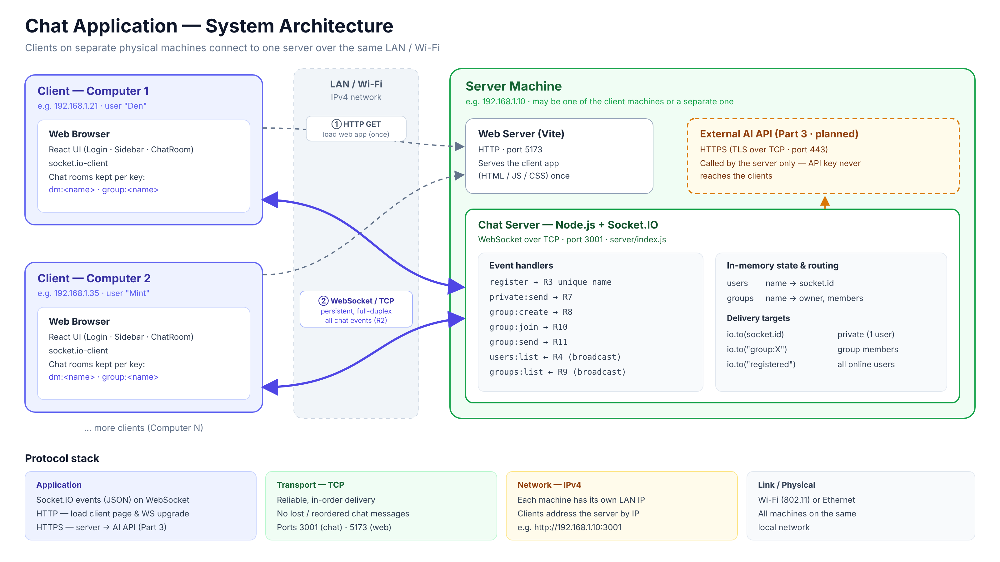

# R1 — System Architecture



> แก้ diagram ได้ที่ `docs/architecture.html` แล้ว render ใหม่เป็น PNG

## ภาพรวม

ระบบเป็นแบบ **Client–Server**
- **Client** (คอมอย่างน้อย 2 เครื่อง) เปิดหน้าเว็บ React ในเบราว์เซอร์
- **Server** (Node.js + Socket.IO) จะรันบนเครื่องใดเครื่องหนึ่งในนั้น หรือเครื่องที่สามก็ได้
- Client **ไม่คุยกันเองตรงๆ** ข้อความทุกข้อความต้องผ่าน server ก่อน แล้ว server จะตัดสินว่าส่งต่อให้ใคร

ขั้นตอนการทำงาน:
1. **โหลดหน้าเว็บ:** เบราว์เซอร์ส่ง HTTP GET ไปที่ `http://<server-ip>:5173` เพื่อโหลดตัวแอป (HTML/JS/CSS) ทำครั้งเดียวตอนเปิดหน้า
2. **เปิด socket:** แอปเปิดการเชื่อมต่อ WebSocket ไปที่ `<server-ip>:3001` แล้วค้างไว้ตลอดการใช้งาน ข้อความแชททุกอย่าง (register, private, group, รายชื่อคน/กลุ่ม) วิ่งผ่านการเชื่อมต่อนี้

## Protocol ที่ใช้

| Layer | Protocol | ใช้ทำอะไรในโปรเจกต์ |
|---|---|---|
| Application | **Socket.IO** (บน WebSocket) | ส่ง event แชททั้งหมดเป็น JSON |
| Application | **WebSocket** | ช่องทางสื่อสารสองทางที่ค้างไว้ระหว่าง client กับ server |
| Application | **HTTP** | โหลดหน้าเว็บ client และใช้ handshake ตอนเปิด WebSocket |
| Application | **HTTPS** | server เรียก AI API ภายนอก (Part 3) |
| Transport | **TCP** | ใต้ HTTP และ WebSocket ทั้งหมด |
| Network | **IPv4** | ระบุเครื่องแต่ละเครื่องใน LAN |
| Link | **Wi-Fi / Ethernet** | ทุกเครื่องอยู่ในเครือข่ายเดียวกัน |

### 1. TCP (Transport layer)
- **คืออะไร:** protocol แบบ connection-oriented ที่รับประกันว่าข้อมูลไปถึงครบ และไปถึงตามลำดับที่ส่ง
- **ทำไมเลือก:** แอปแชทต้องการให้ข้อความ**ไม่หาย**และ**ไม่สลับลำดับ** ถ้าใช้ UDP อาจเจอข้อความ "สวัสดี" มาถึงทีหลัง "ว่าไง" หรือหายไปเลย ซึ่งรับไม่ได้สำหรับแชท ส่วนเรื่อง latency ที่ต่ำกว่าของ UDP ไม่สำคัญกับข้อความตัวอักษร
- **ใช้ยังไง:** ไม่ได้เขียนเอง ใช้ผ่าน WebSocket และ HTTP ที่ทำงานอยู่บน TCP โดย server ฟังที่ port `3001` (แชท) และ `5173` (หน้าเว็บ)

### 2. WebSocket (Application layer)
- **คืออะไร:** protocol ที่เริ่มต้นด้วย HTTP request แบบพิเศษ (`Upgrade: websocket`) จากนั้นเปลี่ยนเป็นช่องทาง **full-duplex** ที่ค้างอยู่บน TCP connection เดิม
- **ทำไมเลือก:**
  - **Server push ได้:** server ส่งข้อความหา client ได้ทันทีโดยไม่ต้องรอ client มาถาม ซึ่งจำเป็นต่อการรับข้อความใหม่แบบ real-time
  - ถ้าใช้ HTTP ปกติ client ต้องคอยถามซ้ำๆ (polling) ทำให้ช้าและเปลือง
  - เบราว์เซอร์รองรับในตัว (ส่วน raw TCP socket ใช้จากเบราว์เซอร์ไม่ได้)
- **ใช้ยังไง:** client ตั้งค่า `transports: ["websocket"]` (`client/src/socket.js`) ให้เปิด WebSocket ตรงๆ แต่ละ client มี 1 connection ค้างไว้กับ server และ**ข้อความแชททั้งหมดวิ่งผ่าน connection นี้** (R2)

### 3. Socket.IO (Application layer บน WebSocket)
- **คืออะไร:** library/protocol ที่สร้างบน WebSocket เพิ่มระบบ **event** ที่มีชื่อ (`emit` / `on`), **acknowledgement** (ตอบกลับผลสำเร็จหรือ error) และ **room** (จัดกลุ่ม socket)
- **ทำไมเลือก:**
  - ระบบ **room** ตรงกับโจทย์ group chat พอดี: `socket.join("group:CN101")` แล้วใช้ `io.to("group:CN101").emit(...)` ส่งได้เฉพาะสมาชิก (R11)
  - **ack** ทำให้ server ตอบ error กลับไปได้ เช่น ชื่อซ้ำ (R3) หรือยังไม่ได้ join กลุ่ม
  - จัดการ reconnect และ heartbeat ให้อัตโนมัติ ทำให้รู้ทันทีเมื่อ client หลุด และอัปเดตรายชื่อ online ได้ (R4)
- **ใช้ยังไง:** รายการ event ทั้งหมดอยู่ใน [`protocol.md`](protocol.md)

  | ทิศทาง | Event | การส่ง |
  |---|---|---|
  | Client → Server | `register`, `private:send`, `group:create`, `group:join`, `group:send` | `socket.emit(..., ack)` |
  | Server → ผู้รับคนเดียว + ผู้ส่ง | `private:message` (R7) | `io.to(socketId).emit(...)` |
  | Server → สมาชิกกลุ่ม | `group:message` (R11) | `io.to("group:<name>").emit(...)` |
  | Server → ทุกคนที่ online | `users:list` (R4), `groups:list` (R9) | `io.to("registered").emit(...)` |

  การกรองว่าใครเห็นข้อความ**ทำที่ server** คนที่ไม่เกี่ยวข้องจะไม่ได้รับข้อมูลตั้งแต่แรก

### 4. HTTP (Application layer)
- **คืออะไร:** protocol แบบ request–response บน TCP
- **ทำไมเลือก:** เป็นวิธีมาตรฐานในการส่งหน้าเว็บให้เบราว์เซอร์ และ WebSocket เองก็ต้องเริ่มจาก HTTP handshake
- **ใช้ยังไง:**
  - Vite dev server ส่งไฟล์แอปที่ port `5173` (ทำครั้งเดียวตอนเปิดหน้า)
  - ตอนเปิด socket จะมี HTTP request `GET /socket.io/?EIO=4&transport=websocket` พร้อม header `Upgrade: websocket` จากนั้นจึงเปลี่ยนเป็น WebSocket
  - **HTTP ไม่ได้ใช้ส่งข้อความแชท**
  - ถ้าเปิด DevTools → Network จะเห็น WebSocket อีกตัวที่ port `5173` ตัวนั้นเป็นของ Vite (hot-reload ตอน dev) ไม่เกี่ยวกับแชท WebSocket ของแชทคือตัวที่ port `3001`

### 5. HTTPS (Part 3: AI feature)
- **คืออะไร:** HTTP ที่เข้ารหัสด้วย TLS
- **ทำไมเลือก:** API ของ AI ภายนอกบังคับใช้ และช่วยปกป้อง API key ระหว่างทาง
- **ใช้ยังไง:** **server** เป็นคนเรียก AI API ไม่ใช่ client ทำให้ API key อยู่แค่บน server (เก็บใน `.env`) แล้วส่งผลลัพธ์กลับไปหา client ผ่าน socket ตามปกติ

### 6. IPv4 + Wi-Fi/Ethernet (Network / Link layer)
- ทุกเครื่องต้องต่อ LAN หรือ Wi-Fi วงเดียวกัน แต่ละเครื่องมี IP ของตัวเอง (เช่น `192.168.1.x`)
- client อ้างถึง server ด้วย IP เช่น `http://192.168.1.10:3001` (ตั้งค่าใน `client/.env` หรือใช้ hostname ของหน้าเว็บอัตโนมัติ)
- server ฟังที่ `0.0.0.0` เพื่อรับการเชื่อมต่อจากทุก network interface ไม่ใช่แค่ localhost

## ตัวอย่าง flow: Den ส่ง private message หา Mint

```
Den (Computer 1)                 Server                    Mint (Computer 2)
     │ emit("private:send",          │                              │
     │   {to:"Mint", text:"hi"})     │                              │
     │──────── WebSocket/TCP ───────►│ users.get("Mint") → socketId │
     │                               │──── private:message ────────►│
     │◄──────── private:message ─────│                              │
     │◄──────── ack {ok:true} ───────│        (Ploy ไม่ได้รับอะไรเลย)    │
```
